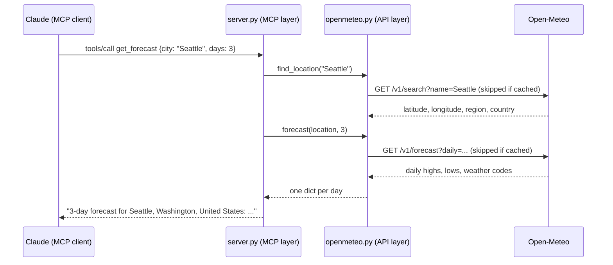

# Weather MCP Server

[](https://github.com/Rusheekb/weather-mcp-server/actions/workflows/ci.yml)

[](LICENSE)

An [MCP (Model Context Protocol)](https://modelcontextprotocol.io) server that gives AI assistants like Claude live weather for any city in the world: current conditions and daily forecasts up to 16 days, powered by the free [Open-Meteo](https://open-meteo.com) API (no API key needed).

```
You:    Should I bring an umbrella in London this weekend?
Claude: (calls get_forecast with city="London", days=4)
        Yes. Saturday has a 96% chance of light rain...
```

## Features

- **Two tools:** `get_current_weather` and `get_forecast`, with typed, validated parameters and read-only tool annotations
- **Any city:** names are resolved to coordinates with Open-Meteo's geocoding API
- **Fahrenheit or Celsius:** wind speed follows (mph or km/h)
- **Caching:** repeat lookups are answered from memory, with per-data expiry times
- **Graceful failures:** unknown cities and API outages come back as readable messages, not crashes
- **Two transports:** stdio for local clients (Claude Code, Claude Desktop) and Streamable HTTP for remote use
- **Tested offline:** 21 tests against a fake API, including end-to-end tests over the MCP protocol, run in CI on Python 3.10–3.13

## Tools

| Tool | Parameters | Example result |
| --- | --- | --- |
| `get_current_weather` | `city` (required), `units` (`fahrenheit` \| `celsius`, default `fahrenheit`) | `Chicago, Illinois, United States: 62.9°F, overcast, 90% humidity, wind 8.6 mph` |
| `get_forecast` | `city` (required), `days` (1–16, default 3), `units` | `3-day forecast for Seattle, Washington, United States:`<br>`- Thu Oct 15: high 62.7°F, low 49.8°F, fog, 0% chance of precipitation`<br>`...` |

## How it works



The code is split into two layers:

- **`openmeteo.py`** (API layer) talks to Open-Meteo and returns plain Python data. It knows nothing about MCP, so it could be reused in a web app or CLI. It also owns the cache.
- **`server.py`** (MCP layer) defines the tools: their parameters, descriptions and the text the model sees. Each tool is a thin wrapper that calls the API layer and formats the answer.

## Setup

Requires Python 3.10+.

```bash
python3 -m venv .venv
source .venv/bin/activate   # Windows: .venv\Scripts\activate
pip install -r requirements.txt
```

### Connect to Claude Code

```bash
claude mcp add weather -- /absolute/path/to/.venv/bin/python /absolute/path/to/server.py
```

Start a new Claude Code session and ask "What's the weather in Tokyo?"

### Connect to Claude Desktop

Add this to `claude_desktop_config.json` (Settings → Developer → Edit Config), then restart Claude Desktop:

```json
{
  "mcpServers": {
    "weather": {
      "command": "/absolute/path/to/.venv/bin/python",
      "args": ["/absolute/path/to/server.py"]
    }
  }
}
```

### Try it in the MCP Inspector

```bash
npx @modelcontextprotocol/inspector@latest
```

Add a STDIO server with **Command** = the absolute path to `.venv/bin/python` and **Arguments** = the absolute path to `server.py`, then connect and run the tools from the **Tools** tab.

Troubleshooting:
- Don't wrap the paths in quotes; the client runs the command directly, so quotes become part of the path (`ENOENT`).
- If your path contains spaces and the connection fails, use a space-free symlink: `ln -s "$(pwd)" ~/weather-mcp`.
- After changing the code, toggle the server off and on so the client restarts it.
- Running `python server.py` by itself prints nothing and seems to hang. That's expected: it is waiting for a client on stdin.

### Run over HTTP

```bash
python server.py --http             # serves http://127.0.0.1:8000/mcp
python server.py --http --port 9000
```

Point any MCP client that supports Streamable HTTP at that URL.

## Tests

```bash
pip install -r requirements-dev.txt
pytest
ruff check .
```

GitHub Actions runs both on every push and pull request, across Python 3.10–3.13.

The tests never hit the network. `conftest.py` provides a fake Open-Meteo API (built on `httpx.MockTransport`) and a fake clock for testing cache expiry. `tests/test_server.py` connects a real MCP client to the server in-process, so the tool schemas, argument validation and responses are tested through the actual protocol.

## Design decisions

- **Errors as text.** Expected failures (unknown city, API down) return a message, so the model can explain what happened to the user. Invalid arguments, such as `days=30`, are rejected by the schema before any API call.
- **Schema from type hints.** Parameters are declared with `Annotated[..., Field(...)]`. The SDK turns those into the JSON Schema the model reads, including descriptions, the units enum and the 1–16 range on `days`, so the code and the schema can't drift apart.
- **Caching with different lifetimes.** City lookups are cached for 24 hours, current conditions for 10 minutes (Open-Meteo refreshes every 15), and forecasts for 30 minutes. Unknown cities are cached too, so a repeated typo costs one API call.
- **Full place names.** "Springfield" exists in many states. Returning "Springfield, Illinois, United States" makes it clear which one was used.
- **Tool annotations.** Both tools are marked read-only and open-world (they call an outside service), so clients know they're safe to run without changing anything.
- **Never write to stdout.** In stdio mode, stdout carries the protocol messages, so the server only logs to stderr.

## Project structure

```
server.py              MCP layer: tools, parameters, response formatting, entry point
openmeteo.py           API layer: Open-Meteo client, weather codes, TTL cache
conftest.py            Test fixtures: fake API, fake clock
tests/
  test_openmeteo.py    API layer tests
  test_server.py       End-to-end tests through an MCP client
requirements.txt       Runtime dependencies
requirements-dev.txt   Adds pytest and ruff
pyproject.toml         Lint and test settings
.github/workflows/     CI: lint + tests on every push
```

## Built with

- [MCP Python SDK](https://github.com/modelcontextprotocol/python-sdk) 2.x (`MCPServer`)
- [httpx](https://www.python-httpx.org) for async HTTP
- [Open-Meteo](https://open-meteo.com) for geocoding and weather data

## License

[MIT](LICENSE)
